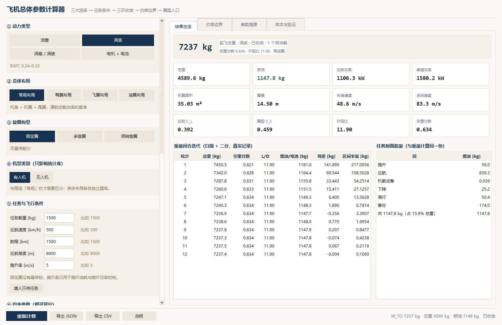
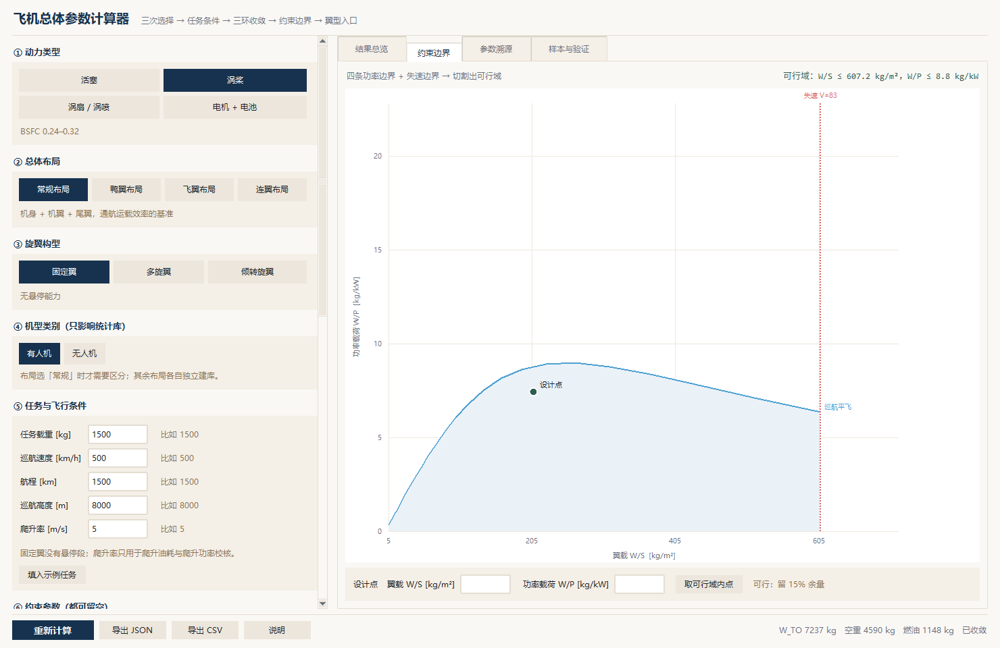

# Aircraft Sizing Calculator · 飞机总体参数计算器

[](#2-快速开始--quick-start)
[](#3-界面--interface)
[](LICENSE)

> Supply payload, cruise speed, range and altitude — get take-off gross weight,
> empty weight, fuel or battery mass, wing area and span, power requirements,
> lift coefficients, and the feasible region on the **W/S–W/P** plane.
> 输入任务载重、巡航速度、航程与高度，用三环迭代反推整机总体参数，
> 并在 W/S–W/P 平面上切出功率与翼载的可行域。

A concept-stage sizing tool for **conventional / canard / flying-wing / joined-wing** layouts ×
**piston / turboprop / turbofan / electric** propulsion × **fixed-wing / multirotor / tiltrotor**
configurations. Pure Python + tkinter, no third-party packages, no network calls.

适用于**常规 / 鸭翼 / 飞翼 / 连翼**布局 × **活塞 / 涡桨 / 涡扇 / 电机**动力 ×
**固定翼 / 多旋翼 / 倾转旋翼**构型的方案阶段粗算。纯 Python + tkinter，无第三方依赖、不联网。

**Quick links:** [快速开始](#2-快速开始--quick-start) ·
[环境自检](#21-环境自检与安装--environment-check-and-setup) ·
[计算流程](#4-计算流程--calculation-pipeline) ·
[数据来源](#7-数据来源--data-sources) ·
[精度验证](#73-验证样本--validation-set) ·
[已知限制](#8-已知限制--known-limitations)



---

## 1. 这是什么 / What this is

从四个输入（任务载重 `W_PL`、巡航速度 `V`、航程 `R`、巡航高度 `h`）出发，用三环迭代反推整机总体参数：
起飞总重、空重、燃油或电池质量、机翼面积与翼展、功率需求、升力系数，并在 W/S–W/P 平面上切出可行域。

Starting from four inputs (payload `W_PL`, cruise speed `V`, range `R`, altitude `h`), the tool
solves for take-off gross weight, empty weight, fuel or battery mass, wing area and span, power
requirements, lift coefficients, and cuts the feasible region on the W/S–W/P plane.

这是概念阶段粗算工具，不是详细设计软件：输出用于比较方案、定参数范围、暴露物理约束，
不能替代 CFD / 结构 / 适航验证。

This is a conceptual-stage sizing tool, not detail-design software. Use it to compare
configurations, bracket parameter ranges and expose physical constraints — not as a
substitute for CFD, structural or airworthiness verification.

---

## 2. 快速开始 / Quick start

**Windows**：双击 `launch_calculator.bat`（无控制台窗口）
**Windows**: double-click `launch_calculator.bat` (no console window)

**命令行 / Command line**：

```bash
python aircraft_sizing_calculator.py
```

要求 / Requirements：Python 3.9 以上，自带 tkinter（标准库）。
Python 3.9+ with the bundled tkinter (stdlib).

第一次打开是空态，点左下「填入示例任务」可以直接看到一整套结果。
On first launch the panel is empty; click **填入示例任务 / Fill example** to load a complete working case.

### 2.1 环境自检与安装 / Environment check and setup

先跑一次自检，确认这台机器能跑：

```text
双击 check_environment.bat
```

依次检查 Python 版本、tkinter、Tcl/Tk、程序文件是否齐全、计算内核能否跑通自检算例，
最后把报告写到 `环境报告.txt`。

Double-click `check_environment.bat`. It verifies the Python version, tkinter, Tcl/Tk, program
files, and runs a core self-test, then writes `环境报告.txt`.

没有 Python 时，双击 `install_environment.bat`：

1. 先在本机找 `py` / `python` / 常见安装目录；
2. 找不到就用 winget 自动装 Python 3.12（用户级安装）；
3. 装好后再跑一遍检查，全部通过时可以直接启动计算器；
4. 没有 winget 的机器会给出 python.org 的手动安装步骤。

Double-click `install_environment.bat` when Python is missing. It looks for `py` / `python` /
common install paths, falls back to `winget install Python.Python.3.12`, re-checks, and can launch
the app once everything passes. Machines without winget get manual python.org instructions.

> 三个 `.bat` 用纯 ASCII 编写（提示文字为英文），避免 Windows 代码页在不同区域设置下把批处理
> 读成乱码；中文提示全部由 Python 端输出。
> The three `.bat` files are written in pure ASCII to stay readable under any Windows code page;
> all Chinese guidance is printed by the Python side.

**常见问题 / Troubleshooting**

| 现象 / Symptom | 处理 / Fix |
|---|---|
| 窗口一闪而过、没反应 / flashes and closes | 没找到 Python。跑 `check_environment.bat`，或 `install_environment.bat` / Python not found |
| `No module named tkinter` | 重跑 Python 安装包 → Modify → 勾选 **tcl/tk and IDLE** |
| 字太小 / 窗口太大 / text too small | 程序按系统 DPI 自动缩放；仍不合适就调 Windows 显示缩放 / adjust display scaling |
| 中文乱码 / garbled Chinese | 用 `.bat` 启动（会先找到合适的解释器），或改用 Python 3.12+ |

---

## 3. 界面 / Interface



左栏八段（滚轮平滑滚动）/ Left column, eight sections (smooth wheel scrolling):

| 段 | 内容 | Content |
|---|---|---|
| ① | 动力类型：活塞 / 涡桨 / 涡扇 / 电机 | Propulsion: piston / turboprop / turbofan / electric |
| ② | 总体布局：常规 / 鸭翼 / 飞翼 / 连翼 | Layout: conventional / canard / flying wing / joined wing |
| ③ | 旋翼构型：固定翼 / 多旋翼 / 倾转旋翼 | Rotor config: fixed wing / multirotor / tiltrotor |
| ④ | 机型类别：有人机 / 无人机（仅常规布局时出现） | Category: manned / UAV (conventional layout only) |
| ⑤ | 任务与飞行条件 | Mission and flight conditions |
| ⑥ | 约束参数（8 项，全部可留空） | Constraints (8 items, all optional) |
| ⑦ | 效率与设计参数 | Efficiency and design parameters |
| ⑧ | 统计覆盖（手动指定空重分数 / 升阻比） | Manual override of empty-weight fraction / L-D |

右侧四页签 / Right side, four tabs:

- **结果总览** — 总重、12 张参数卡、逐轮迭代表 / Gross weight, 12 cards, iteration table
- **约束边界** — W/S–W/P 可行域图，点击或输入设计点 / Feasible-region chart, click or type a design point
- **参数溯源** — 每个参数的公式、上游依赖、来源标签 / Formula, upstream dependencies, source tag for every parameter
- **样本与验证** — 统计曲线图（空重分数 / 升阻比 / 比油耗 / 功重比四选一，可切换）+ 同源样本点表（可一键导出全部样本 CSV）、9 架实机一键复算、数据来源清单 / Statistic curves (four switchable views) with the underlying sample-point table and a whole-library CSV export, 9-aircraft one-click verification, data sources

底部操作条 / Bottom bar：重新计算 / Recompute、导出 JSON / Export JSON、导出 CSV / Export CSV、说明 / About，右侧实时状态 / live status。

---

## 4. 计算流程 / Calculation pipeline

```text
输入任务条件
  ↓
④ 统计选库（空重分数 f_E、升阻比 L/D 随总重的经验曲线）
  ↓
① 重量—能量环：给定 W_TO 初值 → 分段能量/油耗 → 电池或燃油质量 → 空重 → 新 W_TO → 迭代至 0.5%
  ↓
② 功率—翼载环：巡航 / 前飞爬升 / 悬停 / 垂直爬升 / OEI / 过渡 六类功率边界
  ↓
③ 升力系数下推：C_L_cruise → 机翼 C_L → 翼型 C_li → 净最大升力需求
  ↓
约束边界图 + 参数溯源
```

English: statistics library → weight-and-energy loop (segmented energy or fuel burn → battery or
fuel mass → empty weight → new gross weight, iterated to 0.5%) → power-and-wing-loading loop
(six power boundaries) → lift-coefficient push-down → constraint chart and traceability.

燃油与电动的关键差别 / The key fuel-vs-electric difference：

- 燃油：`W_fuel/W_TO = 1 − exp(−R·K)`，燃油分数与总重**无关**，可闭式求解。
- 电动：电池质量 `m_batt = E_mission/(DoD·e_batt)`（并与 `P_peak/(P/m)` 取大），**是总重的函数**，只能迭代。
- Fuel: the fuel fraction is independent of gross weight, so the closure is closed-form.
  Electric: battery mass is a function of gross weight, so the closure must be iterated.

---

## 5. 输入说明 / Inputs

**必填 / Required**：载重 `W_PL` [kg]、巡航速度 `V` [km/h]、航程 `R` [km]、巡航高度 `h` [m]。

**旋翼构型非固定翼时额外必填 / Extra for multirotor and tiltrotor**：
悬停时长 [min]、垂直爬升率 [m/s]、旋翼数量、桨径 [m]。

**可选约束 / Optional constraints**（留空即不考虑 / blank = not applied）：

| 键 | 含义 | 示例 |
|---|---|---|
| 进场速度 | approach speed [km/h] | 留空 = 0.6·V |
| 爬升梯度 | all-engines climb gradient [%] | 比如 5 |
| 单发梯度 | one-engine-inoperative gradient [%] | 比如 2.4 |
| 爬升率 | rate of climb [m/s] | 比如 5 |
| 盘旋过载 | turning load factor | 比如 2.5 |
| 起飞距离 | take-off distance [m] | 比如 600 |
| 着陆距离 | landing distance [m] | 比如 900 |
| 逆风 | headwind [kt] | 比如 10 |

**设计参数 / Design parameters**：翼载 W/S、展弦比、C_Lmax、螺旋桨效率、传动效率、旋翼品质因数。
留空则按统计默认。

**统计覆盖 / Statistics override**：空重分数、升阻比、巡航 L/D 折减（默认 0.85，把库里的 L/Dmax 折到设计巡航点）。

---

## 6. 输出说明 / Outputs

| 输出 | 含义 |
|---|---|
| W_TO | 起飞总重 [kg]，正反馈收敛值 |
| 空重 / 燃油 / 电池 | 三者的质量分配 |
| 巡航功率 / 峰值功率 | 巡航需用功率、各工况最大需用功率 [kW] |
| 机翼面积 / 翼展 | S = W_TO/(W/S)，b = √(AR·S) |
| 失速速度 / 进场速度 | V_s = √(2W/(ρSC_Lmax))，V_app |
| 巡航 C_L / 翼型 C_li | 翼型筛选入口的设计升力系数 |
| 升阻比 / 空重分数 | 实际用到的统计值 |

「无解」的含义 / What "no solution" means：在当前桨径、悬停时长、电池比能量下，空重 + 能源 + 载重
已经超过设计点，重量方程没有自洽解。界面会给出四个可调方向（加大桨径 / 缩短悬停 /
提高电池比能量 / 填更确切的空重分数）。

Under the current rotor diameter, hover time and battery specific energy, empty weight + energy +
payload exceeds the design point, so the weight equation has no self-consistent root.

---

## 7. 数据来源 / Data sources

所有统计曲线都严格穿过样本点（log-log 分段插值），不做平滑拟合。
All statistical curves interpolate through the sample points exactly (piecewise log-log); no smoothing.

### 7.1 空重分数与升阻比 / Empty-weight fraction and L/D

| 数据集 | 样本点 | 内容 | 等级 |
|---|---|---|---|
| 常规 · 有人机 | 70 + 70 | Cessna / Piper / Cirrus / Tecnam / Beech / ATR / CRJ / A320 / B737 / B777 / A380 / C-130 / C-17 公开规格 | B 公开规格 |
| 常规 · 小型无人机 | 37 + 37 | DJI 系列、小型固定翼与多旋翼 UAV（<250 kg） | B 公开规格 |
| 鸭翼布局 | 8 + 7 | Rutan 系列 + 鸭翼 UAV | C 样本有限 |
| 飞翼布局 | 8 + 8 | 小型飞翼 UAV + BWB 概念 | C 样本有限 |
| 连翼布局 | 7 + 7 | 连翼 UAV + 箱式翼概念 | C 样本有限 |

大型无人机（MQ-1 / MQ-9 / RQ-4 级）真实样本不足 10 个，按约定**未建库**，
请用小型无人机库或直接手动填空重分数。
Large UAVs (MQ-1 / MQ-9 / RQ-4 class) have fewer than 10 real samples, so no library was built;
use the small-UAV library or type the empty-weight fraction manually.

等级含义 / Grades：**B** = 公开规格数据，覆盖范围明确；**C** = 样本有限，只宜做趋势参考。
**B** = public specification data with a known coverage range; **C** = sparse samples, trend reference only.

### 7.2 动力系统参数 / Propulsion parameters

| 动力 | 型号来源 | 关键参数 |
|---|---|---|
| 活塞 | Rotax 912/914、Lycoming IO-360、Continental IO-550、Jabiru 2200 | BSFC 0.27–0.35 kg/(kW·h)，功重比 0.85–1.3 kW/kg |
| 涡桨 | PT6A-67、PW127、AE2100、TPE331 | BSFC 0.25–0.32，功重比 3.6–5.8 kW/kg |
| 涡扇 | CFM56-7、LEAP-1A、PW1000G、GE90-115B | 等效 BSFC 0.24–0.31，功重比 5.0–8.8 kW/kg |
| 电机 + 电池 | NASA NTRS 20180005327、20200007148 | 电芯比能量 ≤200 Wh/kg（2020 报告 250 Wh/kg @2C），电机 6.6–9.9 kW/kg |

补充常数 / Additional constants：航空煤油热值 ≈ 12 000 Wh/kg；电池放电深度默认 0.85；
能量裕度默认 20%；备份燃油按 45 min 盘旋 + 5% 航程取大。
Aviation fuel ≈ 12 000 Wh/kg; default depth of discharge 0.85; energy reserve 20%;
fuel reserve = max(45 min hold, 5% range).

### 7.3 验证样本 / Validation set

载重取「满油可用商载」= MTOW − 空重 − 满油可用燃油。
Payload is the full-fuel useful load: MTOW − empty weight − full usable fuel.

| 机型 | 载重 [kg] | 真实总重 [kg] | 算出总重 [kg] | 偏差 |
|---|---|---|---|---|
| Cessna 172S | 237 | 1157 | 1102 | −4.8% |
| Piper PA-28-181 | 271 | 1157 | 940 | −18.8% |
| Diamond DA40 | 238 | 1150 | 1094 | −4.8% |
| Cessna 182T | 272 | 1406 | 1283 | −8.7% |
| Cirrus SR22 | 362 | 1633 | 1709 | +4.7% |
| King Air 350 | 638 | 6804 | 5452 | −19.9% |
| Boeing 737-800 | 15 400 | 79 016 | 78 314 | −0.9% |
| Airbus A330-300 | 36 000 | 242 000 | 248 758 | +2.8% |
| Bombardier Q400 | 7 000 | 29 574 | 30 000 | +1.4% |

平均绝对偏差 7.4%，15% 以内 7 架 / 9 架。
Mean absolute error 7.4%; 7 of 9 within 15%.

---

## 8. 已知限制 / Known limitations

1. **低商载率机型会挑错根**。求解器按典型载荷分数选解，King Air 350 这类载荷分数只有 0.094
   的机型会落到另一个假根上（−19.9%）。
2. **统计库只到公开规格级**。C 级库（鸭翼/飞翼/连翼）样本 7–8 个，只适合看趋势。
3. **电动只做能量与功率两项约束**，不含热管理、循环寿命、低温容量衰减。
4. **不建模旋翼干扰、结构细节、配平**。约束图的可行域是必要条件，不是充分条件。
5. **升阻比取库值 × 0.85**（L/Dmax → 设计巡航点）。若目标机型以 L/Dmax 巡航，
   把统计覆盖里的 L/D 折减改成 1.0。

1. Aircraft with a very low payload fraction may pick the wrong root (King Air 350, −19.9%).
2. Libraries only reach public-specification quality; C-grade ones carry 7–8 points and are trend-only.
3. Electric sizing covers energy and power only — no thermal management, cycle life, or cold-capacity derating.
4. Rotor interference, structural detail and trim are not modelled; the feasible region is necessary, not sufficient.
5. L/D is taken as library value × 0.85 (L/Dmax → design cruise). Set the factor to 1.0 if your aircraft cruises at L/Dmax.

---

## 9. 目录结构 / Repository layout

| 路径 | 说明 |
|---|---|
| `aircraft_sizing_calculator.py` | 主程序：tkinter 界面、四页签、导出 / main GUI |
| `calc_core.py` | 计算内核：统计库、三环收敛、约束边界 / calculation core |
| `launch_calculator.bat` | 启动（找 Python → 无控制台启动 GUI） / launcher |
| `check_environment.bat` | 环境自检入口，输出 `环境报告.txt` / environment check |
| `install_environment.bat` | 缺 Python 时自动安装并复检 / one-click setup |
| `tools/env_check.py` | 自检逻辑：版本、tkinter、文件、内核算例 / check logic |
| `tools/env_setup.py` | 修复建议 + 通过后启动计算器 / repair hints and launch |
| `docs/` | 界面截图 / screenshots |
| `README.md` | 本说明 / this manual |

导出文件 / Exports：JSON（完整结果与溯源）、CSV（迭代表与验证表），保存在当前目录。
JSON (full result plus traceability) and CSV (iteration and verification tables) are written to the working directory.

---

## 10. 免责与口径 / Disclaimer and conventions

速度统一按 km/h 输入，风速按 kt；内部换算成 m/s。载重指**最大任务商载**（满油状态下能背的重量），
不是「总重减空重减部分燃油」。
All speeds are entered in km/h (wind in kt) and converted internally. Payload means the maximum
mission payload with full fuel — not gross weight minus empty weight minus a partial fuel load.

结果仅供方案阶段参考；正式设计请用经适航认可的方法与数据。
Results are for conceptual studies only; use airworthiness-approved methods and data for design.

## License

MIT — see [LICENSE](LICENSE).
